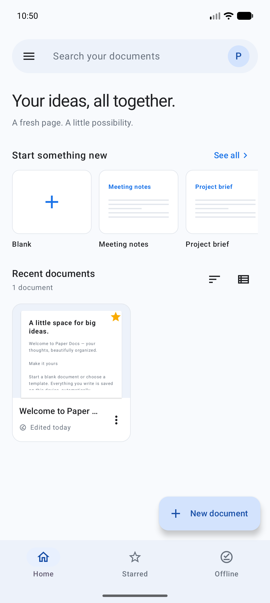
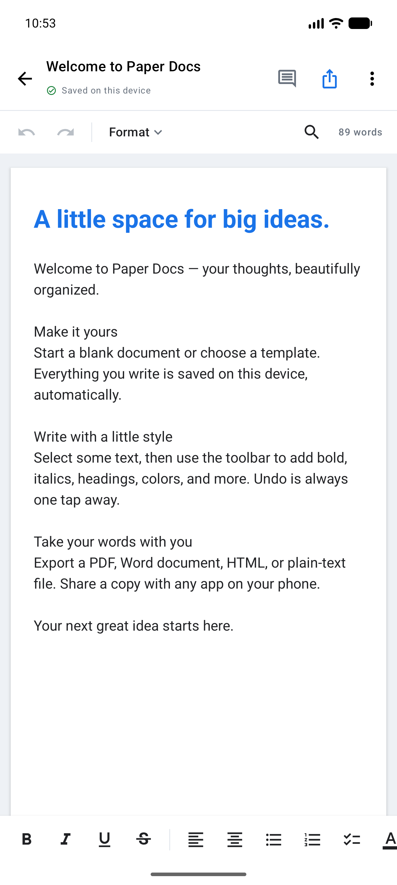

# Paper Docs

A working Google Docs–inspired Android app written in **Kotlin + Jetpack Compose**.
It includes a native rich-text editor, a searchable document library, local
autosave, templates, file import/export, Google sign-in, cloud sync with live
collaboration, and Google Drive backup.

<p>
  
  
</p>

## Website and privacy policy

A static site lives in [`site/`](site/) with the homepage and the privacy policy, ready to
publish on Firebase Hosting at `https://paper-docs-006.web.app`:

```bash
cd site
npx firebase-tools login
npx firebase-tools deploy --only hosting
```

See [`site/README.md`](site/README.md) for the two items to resolve before publishing
(a contact email placeholder, and cloud deletion, which the policy currently flags as
not yet implemented).

## App icon

The launcher icon is a vector drawable at `app/src/main/res/drawable/ic_launcher.xml`. PNG
renderings of the same artwork live in `app/src/main/assets/` for use outside the launcher
(README, store listings, in-app branding):

| File | Size |
| --- | --- |
| `ic_launcher.png` | 512 × 512 (master) |
| `ic_launcher_xxxhdpi.png` | 192 × 192 |
| `ic_launcher_xxhdpi.png` | 144 × 144 |
| `ic_launcher_xhdpi.png` | 96 × 96 |
| `ic_launcher_hdpi.png` | 72 × 72 |
| `ic_launcher_mdpi.png` | 48 × 48 |

The vector stays the source of truth: it is what the launcher actually draws, and it scales
without quality loss. It is also the reference the store feature graphic and the adaptive icon
layers are generated from.

The launcher uses an adaptive icon at `app/src/main/res/mipmap-anydpi-v26/ic_launcher.xml`. Because
`minSdk` is 26, every supported device resolves that file, so no legacy bitmap densities are
needed alongside it. The artwork is split into three layers:

| Layer | Purpose |
| --- | --- |
| `drawable/ic_launcher_background.xml` | Full-bleed `#E8F0FE` fill, masked by the launcher's shape |
| `drawable/ic_launcher_foreground.xml` | The page, fold and text rules, rescaled onto the 108-unit canvas |
| `drawable/ic_launcher_monochrome.xml` | Flat silhouette for Android 13+ themed icons |

The foreground is positioned so the page clears the 72 × 72 region every launcher is required to
keep visible, which means it survives the worst-case circular mask as well as the squircle and
rounded-square shapes.

## Run it

Open this directory in Android Studio, let Gradle sync, and run the **app**
configuration on an emulator or Android device (Android 8.0 / API 26 or newer).

Build prerequisites:

- JDK **17 or 21**. On this machine, Android Studio provides JDK 21 at
  `/opt/android-studio/jbr`; the system JDK 25 is newer than this Gradle version supports.
- Android SDK platform **36.1** and SDK Build Tools **35.0.0**.
- Internet for the initial Gradle/dependency download. The app itself works offline.
- `local.properties` must point `sdk.dir` to your Android SDK. Android Studio can
  generate this file; the workspace copy is already configured for this machine.

```bash
JAVA_HOME=/opt/android-studio/jbr ./gradlew :app:assembleDebug
```

**Installable debug APK:** [`app/build/outputs/apk/debug/app-debug.apk`](app/build/outputs/apk/debug/app-debug.apk)

```bash
adb install -r app/build/outputs/apk/debug/app-debug.apk
adb shell am start -n com.company.paperdocs/.MainActivity
```

For other systems, set `JAVA_HOME` to your own JDK 17/21 path. Windows includes
`gradlew.bat`. The Gradle 8.13 wrapper is included, pinned to the version Android Gradle Plugin
8.13.2 supports — moving it to Gradle 9.x requires moving AGP to 9.x first, because the 8.x
plugin line does not run on Gradle 9. See the note in `gradle/wrapper/gradle-wrapper.properties`
about restoring the distribution checksum.

## Build a release

The release build type enables R8 and resource shrinking. Signing credentials are **never**
committed; they come from a gitignored `keystore.properties` or from `PAPERDOCS_*` environment
variables.

```bash
keytool -genkeypair -v -keystore paperdocs-release.jks -alias paperdocs \
  -keyalg RSA -keysize 4096 -validity 10000
```

```properties
# keystore.properties  (gitignored)
storeFile=/home/you/.keys/paperdocs-release.jks
storePassword=…
keyAlias=paperdocs
keyPassword=…
```

The keystore is kept **outside the repository** so that `git clean -xfd` cannot destroy a key that
cannot be rotated. `storeFile` is an absolute path for that reason; it differs per machine.

Google Play accepts **Android App Bundles**, not APKs, for new apps. That is the upload unit:

```bash
JAVA_HOME=/opt/android-studio/jbr ./gradlew :app:bundleRelease
# app/build/outputs/bundle/release/app-release.aab
```

An APK is still built by `:app:assembleRelease` for sideloading and for CI. Both run R8, resource
shrinking, and `lintVitalRelease`, so anything Google Play blocks a release for fails the build
rather than the upload.

An `.aab` is signed with JAR signing rather than the APK v2 scheme, so verify it with `jarsigner`:

```bash
$JAVA_HOME/bin/jarsigner -verify -certs app/build/outputs/bundle/release/app-release.aab
jar verified.
```

`PKIX path building failed` and `signer certificate is self-signed` are expected and harmless for a
self-signed release key. Confirm the identity actually matches yours:

```bash
unzip -p app/build/outputs/bundle/release/app-release.aab META-INF/PAPERDOC.RSA \
  > /tmp/signer.rsa && $JAVA_HOME/bin/keytool -printcert -file /tmp/signer.rsa
```

Without signing credentials either build still succeeds and emits an unsigned artifact, which is
what an untrusted CI job should produce.

**Register the release fingerprint before shipping.** The OAuth client in `google-services.json`
carries the *debug* SHA-1. A build signed with a different key is rejected by Google sign-in with
error 125 until its SHA-1 is added in **Firebase console → Project settings → Your apps** and in
**Google Cloud Console → APIs & Services → Credentials**. A published signing key cannot be
rotated for an existing Play listing, so back the keystore up before the first upload.

Play App Signing is required for new apps. Enrol this same keystore as the app signing key so the
fingerprint above is the one users' installs actually present. If you let Google generate the key
instead, download that one from **Play Console → Setup → App signing** and register it instead — the
keystore here would then only ever be the upload key.

## Store listing

| Asset | Where it is |
| --- | --- |
| 512 × 512 icon | `app/src/main/assets/ic_launcher.png` |
| 1024 × 500 feature graphic | `play/feature-graphic-1024x500.png` |
| Privacy policy | `site/public/privacy-policy.html`, deployed to `paper-docs-006.web.app` |

Regenerate the feature graphic with `python3 play/make_feature_graphic.py`; it replays the launcher
vector's paths rather than upscaling a PNG, so it stays crisp. Play rejects graphics with an alpha
channel, which is why the script writes RGB.

## Features

### Library

- Grid/list views with document previews, title/content search, and sorting.
- Recent documents, starred documents, on-device documents, and trash.
- Create, rename, duplicate, star, trash, restore, and permanently delete.
- Blank, meeting notes, project brief, weekly planner, and letter templates.
- One editable welcome document on first launch; deleting everything does not
  recreate sample files.

### Editor

- A real Android `EditText` hosted in Compose: native selection handles,
  copy/paste, accessibility, spell-check/IME integration, and hardware keyboard input.
- Bold, italic, underline, strikethrough, font family, size, text color, and highlight.
- Title/heading styles, left/center/right alignment, bullets, numbered lists,
  and text checklists. Enter continues a list; Enter on an empty item ends it.
- In-session undo/redo, find/replace with case matching, word/character counts,
  and a heading outline.
- Automatic local saves with a visible save indicator and retry on failure.
- Up to 30 local recovery snapshots, manual version checkpoints, and restore.
- Private notes with quoted text and resolve/reopen actions.

### Files

| Format | Import | Export |
| --- | --- | --- |
| UTF-8 TXT | Yes | Yes |
| HTML | Basic platform-supported formatting | Yes |
| DOCX | Headings, lists, hyperlinks, tables, inline styles | Yes |
| PDF | No | Paginated A4 output |

Use **Import a document** in the drawer/new-document sheet. In the editor or a
document's menu, choose **Share & export**, then **Save a file** or **Send a copy**.
Saving uses Android's file picker; sharing uses the system Sharesheet and temporary
read grants. No broad storage permissions or Google account are required.

### Account and cloud

- **Google sign-in** through the Credential Manager, backed by Firebase Auth. Google is the
  only account method; there is no email or password option.
- The signed-in user's Google avatar sits in the top-right of the library; tapping it opens the
  account sheet.
- **Realtime sync** of documents to Firestore with Firebase storage.
- **Live collaboration**: collaborator avatars and a presence count for anyone with the
  same document open; remote edits appear in the open document as they land.
- **Conflict handling** that never overwrites silently — a document changed in two places is
  flagged, the local version is kept in version history, and you choose which side wins.
- **Sharing** by email with viewer or editor roles. Collaborators are found through a directory
  document; a viewer can read and export but cannot change the text, and access can be revoked.
- **Live collaboration presence** for anyone with the document open.
- **Google Drive backup** through the Drive REST v3 API, available from the export sheet, and
  **Drive import** that pulls a .docx, .txt, or .html file back into your library.
- **Conflict resolution** prompts showing both versions when a document is edited in two places.
- **Works offline**: with no account, or no network, every local feature keeps working and
  changes sync when connectivity returns.
- **Account and data deletion** from the account sheet: *Delete my cloud data* removes the cloud
  copy and keeps local documents, and *Delete my account and data* removes documents, versions,
  and notes from both the device and the cloud, then deletes the Firebase Auth account. Google
  Play requires an in-app deletion path for any app that lets someone create an account. Cloud
  deletions need a connection; if one cannot complete, nothing local is removed and the app says
  so rather than reporting a deletion that did not happen.

Cloud features activate once a Firebase project is configured. See
**[docs/CLOUD_SETUP.md](docs/CLOUD_SETUP.md)** for the exact console steps, the debug
SHA-1 to register, and troubleshooting.

## Scope and format fidelity

This is a functional **offline-first reconstruction of the core document workflow**,
with an original interface and implementation. It is not the complete Google Docs
service or a pixel-exact recreation of the analyzed release.

- Google sign-in and Firestore sync are implemented and **verified end to end** against a live
  Firebase project (document upload acknowledged by the server). Drive backup is implemented
  but has not yet been exercised against the real Drive API.
- Sync never reports false success: a failed upload shows as *Not synced* with the reason,
  and retryable failures back off and retry. See `docs/CLOUD_SETUP.md` for the project setup.
- Sharing supports **viewer** and **editor** only; there is no commenter role, shared **comments**,
  **suggestions/tracked changes**, or Gemini. Shared documents sync live rather than as snapshots.
- Finding a collaborator by email uses a directory document readable by any signed-in user, so a
  signed-in user could in principle enumerate who uses the app. A Cloud Function that resolves
  email to uid server side would remove this.
- Concurrent editing merges at whole-document granularity: the newest version wins, and a
  genuine simultaneous edit is surfaced as a conflict you resolve by keeping your copy or the
  cloud copy. Nothing is discarded silently. This is document level sync, not character-level
  collaborative merging.
- Notes are private, and their quoted text is a snapshot rather than a live anchor.
- DOCX support now covers paragraph styles, real Word numbering (bulleted and numbered),
  hyperlinks, tables, and inline formatting. Images, tracked changes, headers/footers,
  embedded objects, comments, and complex Word layouts are still not preserved.
  Checklists remain text markers rather than Word content controls.
- HTML import uses Android's built-in HTML decoder, so not every CSS style survives.
- Font sizes are displayed in Android text units and mapped approximately to Word;
  exports do not claim pixel-identical layout across editors.
- The editor limit is 1 million UTF-16 code units. Imports are bounded to 16 MiB
  compressed/file input, 8 MiB per DOCX member, and 32 MiB total decompression.
- Autosave runs in an ordered background queue. A sudden force-stop/power loss
  before the visible **Saved on this device** indicator can lose in-flight edits.
- This build uses a light theme. PDFs paginate; the editable canvas is continuous.

## Implementation map

```text
app/src/main/java/com/company/paperdocs/
├── MainActivity.kt                 App, pickers, export/share orchestration
├── DocsApplication.kt              App-scoped document store
├── DocsViewModel.kt                Screen state and document operations
├── data/
│   ├── Models.kt                  Documents, styles, templates, notes, sync state
│   └── DocumentStore.kt           SQLite, ordered writes, snapshots, sync conflicts
├── editor/
│   ├── RichEditor.kt              Native editor, formatting, undo, search
│   └── RichTextCodec.kt           Versioned JSON ↔ Android spans
├── cloud/
│   ├── AccountManager.kt          Google sign-in, Firebase Auth, Drive tokens
│   ├── CloudSync.kt               Firestore documents, presence, sharing
│   └── DriveSync.kt               Google Drive REST v3 client
├── io/
│   ├── DocumentFiles.kt           Import/export entry points, PDF and HTML writers
│   ├── DocxCodec.kt               Word reading/writing, numbering, tables, links
│   └── TableCodec.kt              Table reconstruction and Word table output
└── ui/                           Compose library, editor, account sheet, theme
```

The database stores metadata and span-encoded content atomically. Saves update
content/title independently of star/trash flags. Foreign keys remove notes and
versions with a permanently deleted document. File conversion runs off the UI
thread. Editor UI is native Kotlin; no editor WebView is used.

## Verification

Three suites, because the app has three separate kinds of logic to get wrong.

**Unit tests** (JVM) and **instrumentation tests** (device or emulator):

```bash
JAVA_HOME=/opt/android-studio/jbr ./gradlew \
  :app:assembleDebug :app:testDebugUnitTest \
  :app:connectedDebugAndroidTest :app:lintDebug
```

Instrumentation tests need a running emulator or attached device. Coverage includes:

- Unicode word counting and invalid style ranges.
- Partial formatting removal and JSON/span round-trips.
- Caret formatting, list continuation, undo/redo, and replace-all.
- Ordered database writes, reopen persistence, star preservation, notes,
  version snapshots, trash/restore, and cascading deletion.
- Full local wipe for account deletion: documents, notes, and versions all go.
- DOCX round-trip text/styles, headings, real list numbering, hyperlinks, and the
  `numbering.xml`/hyperlink package parts; malformed XML rejection.
- Sync conflict rules: newer remote adopted, simultaneous edits flagged, both sides
  recoverable, and both resolution paths.
- PDF opening/page dimensions/pagination and HTML escaping.

**Firestore security rules** (Node, against the emulator). The rules are the app's only
enforced security boundary and they run on Google's servers, so no Kotlin test can
observe them:

```bash
npm ci
npm run test:rules:emulated
```

19 tests cover the editor access-control restriction, the email-directory binding,
the share and presence index leaks, and the legitimate reads alongside them. This
suite has already caught a ruleset that compiled, deployed, and silently denied
everything it was meant to allow. See [`docs/CLOUD_SETUP.md`](docs/CLOUD_SETUP.md).

Reports: `app/build/reports/tests/testDebugUnitTest/`,
`app/build/reports/androidTests/connected/debug/`, and
`app/build/reports/lint-results-debug.html`.

### Known gap

`WorkspaceUiTest.documentCanBeWrittenRenamedReopenedAndRecreated` is quarantined with
`@Ignore`. It is the widest user flow in the app — create, rename, type, search,
reopen, survive recreation — and it passes on a local emulator but fails on every CI
run at the rename step. It is not flaky: the click succeeds and the dialog's editable
field is simply absent from the Compose tree afterwards. The likely cause is that the
`AlertDialog` renders into its own window that Compose's node queries cannot see,
which is unconfirmed. The annotation carries the full diagnosis and the cheapest next
step. The other 14 instrumentation tests still run and still gate `main`.

### Continuous integration

`.github/workflows/verify.yml` runs on every push and pull request:
`assembleRelease` (which includes `lintVitalRelease`, so anything Play would reject at
upload fails the build instead), `testDebugUnitTest`, and the Firestore rules suite.
It archives the release APK and `mapping.txt` per commit SHA, because an obfuscated
stack trace cannot be read back without the mapping.

`.github/workflows/instrumentation.yml` runs the emulator suite on `main` and nightly,
off the pull request path.

Pull request builds are deliberately **unsigned**. The release signing key cannot be
rotated once published, so it is never given to CI on an untrusted build.

## Licence

Proprietary. See [`LICENSE`](LICENSE).

## REA research

The supplied Google Docs APK was inventoried with **REA 6.5.0**. The Android SDK's
`aapt2` supplied additional manifest/resource observations, and Google's official
Android help supplied documented workflows. No Google source code or packaged
assets were copied into the app.

See [`research/FINDINGS.md`](research/FINDINGS.md) for the APK version/digest,
REA Evidence IDs, exact sources, the finding checklist, and remaining unknowns.
The absent JADX MCP provider blocked REA package/class/method inspection; this is
documented explicitly. No Google Docs runtime behavior was observed.

The full archive evidence remains locally in `research/base-artifact.json`.
`research/artifact-summary.json` contains a compact summary. Generated large SDK
reports, build output, downloaded tools, and APKs are ignored by `.gitignore`.
